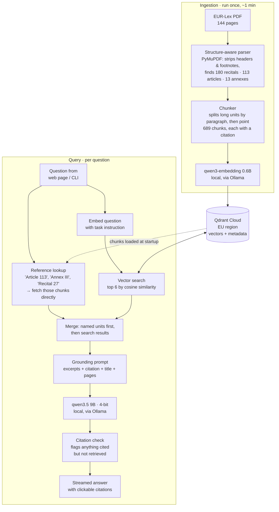

# AI Act RAG

**Ask questions about the EU AI Act and get answers that cite the exact article and page, from models that run entirely on a laptop.**

> **Q:** Is emotion recognition at work allowed?
>
> **A:** No, emotion recognition systems are prohibited in workplaces unless they are intended for medical or safety reasons. Article 5(1)(f) explicitly prohibits the placing on the market, putting into service, or use of AI systems to infer emotions in workplace areas… **[Article 5(1)(f), p. 51]**

A retrieval-augmented generation (RAG) system over [Regulation (EU) 2024/1689](https://eur-lex.europa.eu/eli/reg/2024/1689/oj). It parses the Official Journal PDF into its legal structure, retrieves the passages that answer a question, and has a local LLM answer **only from those passages**. Every claim carries a citation like `[Article 26(1), p. 67]`, and the system says so when the text doesn't cover the question.

## Highlights

- **Citations down to the paragraph and point.** Chunks follow the law's own structure (recital → article → paragraph → point), so answers can cite `Article 5(1)(f)`, not just "page 51".
- **Private by design.** The embedding model and the LLM run locally via Ollama. Only public law text and its vectors are stored, in a Qdrant cluster in the EU.
- **Decisions backed by measurement.** On a 36-question evaluation set, **34 answers cite the correct legal unit, off-topic questions are refused, and no answer cites a provision it wasn't shown.** The same evaluation showed that the popular "hybrid search" scored *worse* than vector search on this corpus, so the system uses what measured best.
- **Guards against hallucination.** A strict grounding prompt, a fixed refusal sentence, and an automatic check that flags any citation the model wasn't actually given.
- **Streaming web UI.** Sources appear in ~1.5 s, then the answer streams in token by token. Citations are clickable and open the source text.

## Architecture



## How it works

**1. Parsing the law, not just the PDF.** Generic RAG splitters cut text every N tokens, so a chunk might hold the end of Article 25 and the start of Article 26, and lose any meaningful citation. This parser uses the PDF's layout instead:
- repeated headers and footers are removed;
- footnotes are detected by the short rule drawn above them *and* their smaller font. The font check matters because Articles 102–110 quote footnotes from other laws, and those quotes are real content;
- headings only count when they carry the *next expected number*, so a sentence that happens to wrap before "Article 49" isn't mistaken for a new article;
- titles that wrap over two lines are joined using their bold font.

The parser finds exactly 180 recitals, 113 articles and 13 annexes, which matches the regulation.

**2. Chunking by legal unit.** Units of up to 500 words stay whole. Longer ones are split into numbered paragraphs, and then into lettered points where needed (Article 5(1) → 5(1)(a)…(h)). The unit's opening sentence is repeated in every piece, so each chunk makes sense on its own. One edge case: `(i)` can be the letter *i* or the roman numeral *i*. A roman list always continues with `(ii)` before any `(j)`, and the chunker uses that to tell them apart.

**3. Retrieval.** Questions are embedded with an instruction prefix, the asymmetric query format Qwen3-embedding was trained with, and matched against the chunks in Qdrant. If a question names a unit ("What does Article 113 say?"), those chunks are fetched directly by their metadata and placed first. Search alone can't do this, because "Recital 27" never appears in the recital's own text.

**4. Grounded generation.** The LLM sees each excerpt with its citation, title and pages. It must cite after every claim, prefer binding articles over explanatory recitals, and answer with a fixed refusal sentence when the excerpts don't cover the question. Afterwards, a regex checks every citation in the answer against the retrieved chunks.

## Evaluation

36 questions, each labelled with the legal units that answer it. They cover definitions, prohibitions, high-risk obligations, transparency, general-purpose AI, and questions that name a unit directly. Two extra off-topic questions check that the system refuses.

| Retriever | hit@1 | hit@3 | hit@5 | MRR |
|---|---|---|---|---|
| **Vector + reference lookup (default)** | **67%** | **89%** | **94%** | **0.78** |
| Vector only | 58% | 81% | 86% | 0.69 |
| Hybrid + reference lookup | 53% | 78% | 86% | 0.67 |
| Hybrid (vector + BM25, reciprocal rank fusion) | 44% | 69% | 81% | 0.59 |
| BM25 keyword search only | 33% | 58% | 67% | 0.47 |

*hit@k: the right unit is in the top k results. MRR: mean of 1/rank of the first correct result.*

**What the numbers showed:**
- Users ask in everyday words ("facial recognition", "job applicants"), while the law uses legal terms ("remote biometric identification", "recruitment"). BM25 matches words, not meaning, so it misses these. Fusing it in pushed good results down.
- LlamaIndex's reciprocal rank fusion ignores retriever weights, and weighted alternatives didn't beat plain vector search either.
- Questions that *name* a unit failed for every search method, so I added the reference lookup. It took hit@5 from 86% to 94%.

**End-to-end answers** (all 38 questions through the full pipeline with `qwen3.5:9b`):

| Metric | Result |
|---|---|
| Answers citing an expected legal unit | **34 / 36 (94%)** |
| Off-topic questions correctly refused | **2 / 2** |
| Citations not backed by a retrieved source | **0 of 173** |
| Average time per answer | ~20 s on a laptop |

The two misses are the retrieval gaps listed under Limitations. In one of them the model correctly *refused* rather than guess, because Annex III wasn't among its sources.

Every run is saved to [`results/`](results/) with the git commit, model settings, per-question ranks, full answers and their sources, so results can be traced to the code that produced them. Run it yourself with `uv run python -m ai_act_rag.evaluation.run --answers`.

## Performance

On a MacBook Pro M1 Pro with 16 GB RAM, with nothing running in the cloud except the vector database:

| Step | Time |
|---|---|
| Index all 689 chunks (embed + upload) | ~65 s |
| Retrieval (sources shown in the UI) | ~1.5 s |
| First answer token (warm model) | ~8–10 s |
| Generation speed | ~28 tokens/s |
| Full answer | ~18–25 s |

Memory was tuned to fit the laptop. An 8k context made the 9B model take 9.9 GB and pushed the Mac into swap. Prompts are under 3k tokens, so a 4k context is enough (7.7 GB). Idle models are unloaded after 2 minutes.

## Tech stack

| Layer | Choice | Why |
|---|---|---|
| PDF parsing | PyMuPDF | Gives layout details (font, bold, position, drawn lines) needed to find structure and footnotes |
| Framework | LlamaIndex (core + integrations only) | Nodes, retrievers, streaming query engine. Settings are explicit, so nothing falls back to OpenAI. |
| Embeddings | `qwen3-embedding:0.6b` via Ollama | Small, strong, local |
| LLM | `qwen3.5:9b` (4-bit) via Ollama | Good instruction-following that fits in 16 GB |
| Vector DB | Qdrant Cloud, EU region | Managed, with metadata filtering and payload indexes; data stays in the EU |
| Keyword search | BM25 (`bm25s`) | Implemented and evaluated; not the default (see Evaluation) |
| API / UI | FastAPI, NDJSON streaming, plain HTML + JS | No build step and no external scripts |
| Tooling | uv, Python 3.12, Docker | Fast, reproducible installs via `uv.lock`; a slim, non-root app image |

## Quickstart

Requires [uv](https://docs.astral.sh/uv/), [Ollama](https://ollama.com) and a free [Qdrant Cloud](https://cloud.qdrant.io) cluster.

```bash
git clone https://github.com/Danyalalam/ai-act-rag.git && cd ai-act-rag
uv sync                                   # install dependencies
ollama pull qwen3-embedding:0.6b          # embedding model (~640 MB)
ollama pull qwen3.5:9b                    # LLM (~7.6 GB)
cp .env.example .env                      # then add your QDRANT_URL and QDRANT_API_KEY

# Download the AI Act PDF from EUR-Lex and save it as data/ai-act.pdf
uv run python -m ai_act_rag.ingestion.index            # parse, chunk, embed, upload

uv run uvicorn ai_act_rag.api.app:app                  # open http://localhost:8000
uv run python -m ai_act_rag.generation.answer "Do deepfakes have to be labelled?"   # or in the terminal
```

### With Docker

The image contains only the app. The models stay in Ollama, because Docker on macOS can't use the Apple GPU.

```bash
docker compose up --build                 # Mac: app in Docker, Ollama native → http://localhost:8000

# Linux server with an NVIDIA GPU: Ollama as a second container
OLLAMA_BASE_URL=http://ollama:11434 docker compose --profile ollama up --build
docker compose exec ollama ollama pull qwen3-embedding:0.6b
docker compose exec ollama ollama pull qwen3.5:9b
```

## Project structure

```
src/ai_act_rag/
├── config.py            # .env loading, Qdrant client
├── models.py            # Ollama embedding model + LLM, LlamaIndex Settings
├── ingestion/
│   ├── parse.py         # PDF → clean lines → recitals, articles, annexes
│   ├── chunk.py         # units → paragraph/point chunks with citations
│   └── index.py         # chunks → TextNodes → embeddings → Qdrant
├── retrieval/
│   ├── vector.py        # vector search
│   ├── keyword.py       # BM25
│   ├── hybrid.py        # reciprocal rank fusion
│   └── references.py    # direct lookup of named units (default retriever)
├── generation/
│   └── answer.py        # grounding prompt, streaming, citation check
├── evaluation/
│   ├── questions.py     # labelled test set
│   └── run.py           # hit@k, MRR, answer checks
└── api/
    ├── app.py           # FastAPI: streaming /ask endpoint
    └── static/index.html
```

## Limitations and next steps

Known gaps, found by the evaluation:

- **Broad questions get partial answers.** Only the top 6 chunks reach the LLM, so "What obligations do deployers have?" cites 5 of Article 26's 12 paragraphs. Next: expand a hit to its whole article when space allows.
- **Two retrieval misses remain.** "When does the regulation apply?" misses Article 113, and "Which areas are high-risk?" misses Annex III. Next: a local cross-encoder reranker, measured on the same test set.
- **The original text only.** The index covers the regulation as published on 12 July 2024. It does not include later amendments or guidance.
- **Single user.** One LLM call at a time, by design for a laptop. A server deployment would use a GPU-backed model server.
- **Local runtime hiccups.** Ollama's Apple-GPU (MLX) runner occasionally crashes while reading a prompt: 5 of 38 questions in the evaluation failed once. The API and the evaluation retry automatically, and all 38 succeeded.
- Planned: unit tests for the parser and chunker.

---

*Not legal advice. Built by [Danyal](https://github.com/Danyalalam) as a hands-on project in retrieval, evaluation and local LLMs.*
